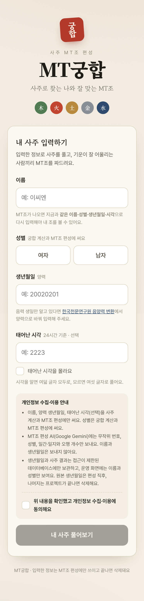
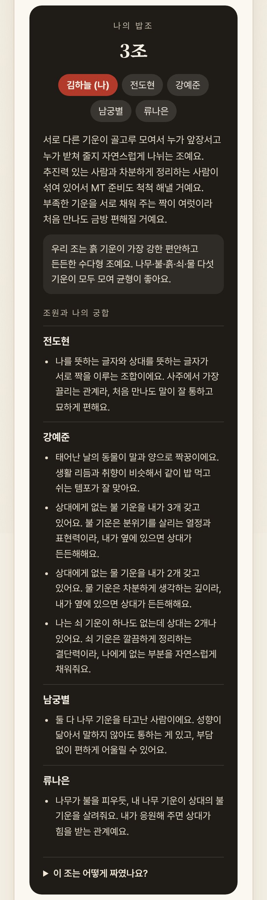
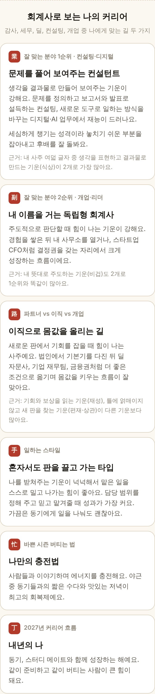
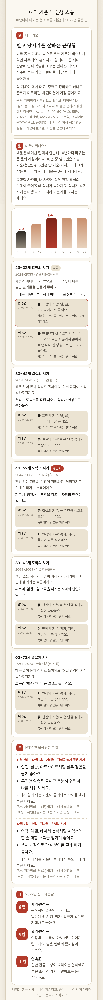
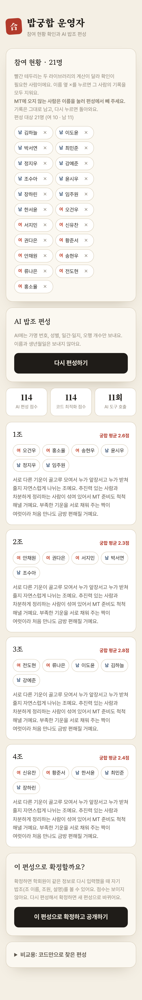

# 밥궁합

**사주로 찾는 나와 잘 맞는 밥조.** 회계학회 학회원 27명이 생년월일을 입력하면, 서버가 만세력으로 사주를 계산하고 AI 에이전트(Google Gemini)가 궁합 도구를 호출해 5개 조(6·6·5·5·5명)로 편성한다. 학회원은 자기 사주 풀이, 회계사 커리어 해석, 10년 단위 흐름(대운)과 "내 밥조"를 본다. 2026년 11월 학회 MT 조 편성에 실제로 썼다.

- 배포: Vercel(서버 함수) + Supabase(PostgreSQL, RLS)
- 팀: 2명. AI 에이전트·입력/결과 페이지·DB·보안 설계(김치연), 궁합 기준 설계·검증·분석(팀원)

> 아래 스크린샷은 모두 **가상 데이터**로 만든 화면이다. 실제 학회원 정보는 저장소에 올리지 않는다.

## 화면

| 입력 | 1. 사주와 나 | 2. 내 밥조 |
| --- | --- | --- |
|  |  |  |

| 2. 회계사 커리어 | 3. 인생 흐름(대운) | 운영자 편성 화면 |
| --- | --- | --- |
|  |  |  |

결과는 휴대폰에서 끝까지 읽히도록 3페이지(탭 + "다음 페이지" 버튼)로 나눴다.

1. **사주와 나**: 일주 동물, 사주 여덟 글자와 오행 분포, 연애·재물 풀이, 매력 지수와 신살(도화·홍염·역마·괴강), 2027년 운세, 나와 잘 맞는 사람
2. **밥조·커리어**: 내 밥조(조 설명, 조 기운, 조원별 궁합을 잘 맞는 순서로) / 입사 부서 1·2순위(감사·세무·딜·컨설팅 중, 추천 세부 팀과 근거), 그다음 커리어(파트너·이직·개업, 대운 황금기와 연결), 일하는 스타일, 바쁜 시즌 충전법, 2027년 커리어 흐름
3. **인생 흐름**: 나의 기운(직진형·균형형·흡수형과 % 근거), 대운 그래프와 10년 카드(연도·간지·앞/뒤 5년), MT 이후 올해 남은 두 달, 2027년 힘이 되는 달

## AI를 어디에 쓰고, 어디에 안 쓰는가

환각이 생기면 안 되는 **판정은 코드**가, 여러 안을 비교하고 사람에게 설명하는 **판단과 언어는 AI**가 맡는다.

| 단계 | 담당 | 내용 |
| --- | --- | --- |
| 사주 계산 | 코드 | `manseryeok`(한국천문연구원 기준)로 계산하고 `lunar-javascript`로 교차검증. 진태양시 보정, 절기 기준 월주 |
| 궁합 점수 | 코드 | `lib/compat.js`: 천간합 +3, 육합 +2, 상생 +1, 없는 오행 보완 +1, 연인 기운 +2, 충 −2 |
| 개인 풀이 | 코드 | `lib/reading.js`, `career.js`, `flow.js`, `specials.js`, `match.js`, `character.js`: 규칙 기반 문장 생성. 모든 카드에 사주 근거 한 줄 |
| 조 편성 | **AI 에이전트** | `lib/agent.js`: Gemini 함수 호출. 도구 5개(`baseline_groups`, `person_overview`, `pair_compatibility`, `evaluate_groups`, `submit_groups`)로 코드 기준안에서 출발해 후보안을 만들고 비교해 제출 |
| 조 설명 | **AI** | 조원들이 서로 어떤 기운을 채워 주는지 쉬운 해요체 3~4문장으로 설명. 가명 번호와 연애 표현은 쓰지 않게 지시 |
| 규칙 검증 | 코드 | 제출안이 전원 한 번씩, 조 인원, 조별 성비를 지키는지, 목표 점수가 코드 기준안 이상인지 서버가 검사. 어기면 거절하고 다시 시키기 |
| 대체 경로 | 코드 | AI 실패(한도 초과·45초 초과·20턴 초과) 시 코드 최적화 편성안(`baselineGrouping`)으로 대체하고 사유 기록 |

에이전트의 목표 함수는 `전체 궁합 합계 + 가중치 × 가장 약한 조의 한 쌍 평균`이다. 그래서 몇 조만 아주 좋고 한 조가 버려지는 편성을 피한다. 인원이 다른 조는 합계 대신 한 쌍 평균으로 비교한다. 서버는 AI 제출안의 목표 점수가 코드 최적화안(`baselineGrouping`, 40회 재시작 지역 탐색)보다 낮으면 거절한다. 그래서 확정되는 편성은 항상 기준선 이상이고, AI는 그 위에서 더 나은 조합을 찾거나 기준안을 받아들여 조마다 설명을 쓴다. 운영자 화면에는 두 점수가 나란히 나온다.

### 편성 규칙

- **조 인원**: 5명씩 묶고, 남는 사람은 4명 조 대신 기존 조에 붙여 최대 6명. 27명 → 6·6·5·5·5, 23명 → 6·6·6·5
- **성비**: 조마다 남녀를 최대한 고르게. 27명(남 11·여 16) → 6명 조 남2여4·남3여3, 5명 조 남2여3 ×3

## 사주 해석 기준

한국에서 가장 널리 쓰는 **자평명리**(십성·신강약·억부법)를 기준으로 했다.

- **십성**: 비겁·식상·재성·관성·인성 다섯 묶음
- **신강약**: 득령(월지 30%), 득지(일지·시지 15%), 득세(나머지 10%씩)에 지장간 비율을 더해 일간을 돕는 기운의 비중을 계산한다. 55% 이상이면 직진형(신강), 45% 미만이면 흡수형(신약), 그 사이는 균형형(중화)으로 본다.
- **억부 용신**: 신강은 식상·재성·관성, 신약은 비겁·인성이 들어올 때 힘이 된다. 균형형은 내 사주에 가장 적은 십성 두 묶음이 들어올 때 힘이 된다. 대운 막대, 2027년 좋은 달, 남은 두 달이 모두 이 기준을 쓴다.
- **아직 반영하지 않은 것**: 격국, 조후 용신, 궁합의 원진·형
- 커리어 부서 연결은 십성 직업론(관성은 조직, 재성은 돈 등)에 기댄 현대식 해석이다. 행운의 색·숫자처럼 근거 없는 요소는 넣지 않았다.

## 보안 설계

- **최소 수집과 동의**: 이름(닉네임), 성별, 양력 생년월일, 시각(선택)만 받는다. 제출 전에 동의를 받고, 동의 시각과 문구 버전을 저장한다.
- **가명 처리**: 신원(`participants`), 원본 생년월일(`birth_inputs`), 사주 결과(`saju_results`)를 테이블로 나누고 무작위 UUID로만 잇는다.
- **접근 통제**: 모든 테이블에 RLS를 켜고 정책을 두지 않는다. 브라우저용 공개 키로는 아무것도 읽거나 쓸 수 없고, 서버 함수의 `service_role` 키로만 접근한다. 이 키는 Vercel 환경변수에만 둔다.
- **AI 전송 최소화와 재식별 방지**: AI에는 매번 새로 섞은 가명 번호(P01…), 성별, 일간·일지, 오행 개수만 보낸다. 연주·월주까지 보내면 생년월일을 역산할 수 있어서 뺐다. 이름과 생년월일은 보내지 않는다. Gemini 무료 등급은 입력이 서비스 개선에 쓰일 수 있는데, 이 위험은 최소 전송으로 낮추고 남은 위험은 동의 안내에 고지했다.
- **AI 판단 통제와 감사 추적**: 점수는 코드가 계산하고 AI는 도구 결과만 따른다. AI에 보낸 데이터, 도구 호출 과정, 결과, 기준선 점수를 `grouping_runs`에 남긴다.
- **공개 통제**: 편성을 돌려도 학회원에게는 보이지 않는다. 운영자가 "확정·공개"를 눌러야 `bapjo_assignments`에 저장되고, 학회원이 같은 정보로 다시 입력하면 서버가 저장된 사주 글자와 대조해 본인을 확인하고 "내 밥조"를 보여 준다. 조원에게는 이름과 궁합 문장만 보여 주고, 조원의 사주 글자와 점수는 내려보내지 않는다.
- **운영자 화면 최소 노출**: `/admin.html`은 `ADMIN_PASSWORD`로 보호한다(상수 시간 비교). 운영자도 참여자의 사주표를 보지 않는다. 실명은 서버에서만 가명 번호와 다시 연결한다. 비학회원이나 삭제를 원하는 사람은 운영자 화면에서 지우면 생일·사주·밥조 기록까지 함께 삭제된다(on delete cascade).
- **악용 방지**: 초대코드, 봇용 숨김 필드, 같은 이름·같은 생일 중복 차단
- **보관 기간**: 편성 직후 원본 생년월일(`birth_inputs`)을 삭제하고(이후 본인 확인은 사주 글자로 한다), 프로젝트가 끝나면 전부 삭제한다.
- **계산 정확성**: 두 라이브러리 결과가 다르면 `cross_check_ok = false`로 표시한다. `npm run crosscheck`로 무작위 5,000건을 비교해 100% 일치를 확인했다.
- **공급망**: 라이브러리 버전을 고정하고 `npm audit`으로 점검한다(2026-11-04 기준 취약점 0건).

### 공개 저장소 원칙

- 비밀값(Supabase 키, Gemini API 키, 초대코드, 운영자 비밀번호)은 Vercel 환경변수에만 둔다. `.env*`는 `.gitignore`로 막는다.
- 비밀값을 실수로 커밋하면 커밋 삭제로 끝내지 않고 즉시 키를 재발급한다.
- 실제 참여자 데이터와 그 데이터가 보이는 스크린샷은 올리지 않는다. 테스트와 스크린샷에는 가상 데이터만 쓴다.

## 구조

| 구성 | 파일 |
| --- | --- |
| 입력·결과 페이지 | `public/index.html` |
| 운영자 페이지 | `public/admin.html` |
| 입력 처리 서버 함수 | `api/submit.js`: 검증 → 사주 계산 → 교차검증 → 저장 → 본인 결과(+공개된 내 밥조) 반환 |
| 편성 서버 함수 | `api/group.js`: 현황, 편성 실행(AI → 실패 시 코드), 확정·공개, 참여자 삭제 |
| 사주 계산 | `lib/saju.js` |
| 궁합·편성 규칙 | `lib/compat.js` |
| AI 에이전트 | `lib/agent.js` |
| 결과 풀이 | `lib/reading.js`, `lib/career.js`, `lib/flow.js`, `lib/specials.js`, `lib/match.js`, `lib/character.js` |
| DB 스키마 | `supabase/schema.sql` |

## 배포 방법

1. **Supabase**: 새 프로젝트(리전 Seoul)를 만들고 SQL Editor에서 `supabase/schema.sql`을 실행한다. Project Settings > API에서 `Project URL`과 `service_role` 키를 복사한다.
2. **Vercel**: GitHub 저장소를 가져와 Framework Preset `Other`로 만들고, 환경변수 6개를 넣고 배포한다.
   - `SUPABASE_URL`, `SUPABASE_SERVICE_ROLE_KEY`
   - `INVITE_CODE`: 추측할 수 없는 무작위 문자열
   - `ADMIN_PASSWORD`: 운영자 페이지 비밀번호
   - `GEMINI_API_KEY`: Google AI Studio API 키(무료 등급)
   - `GEMINI_MODEL`(선택): 기본값 `gemini-3.6-flash`
3. 학회원에게 `https://<배포주소>/?code=<INVITE_CODE>` 링크를 보낸다.
4. 모두 입력하면 `/admin.html`에서 편성을 돌려 보고, 마음에 드는 결과로 "확정·공개"를 누른다.

## 로컬 검증

```bash
npm install
npm run crosscheck   # 두 만세력 라이브러리 5,000건 비교
npm audit
```
